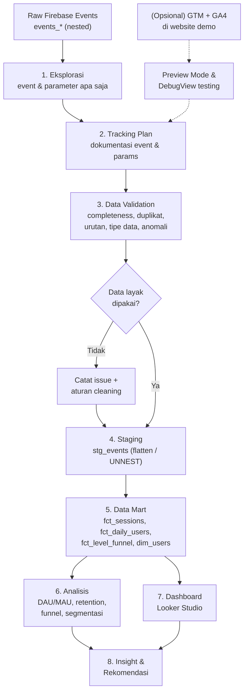
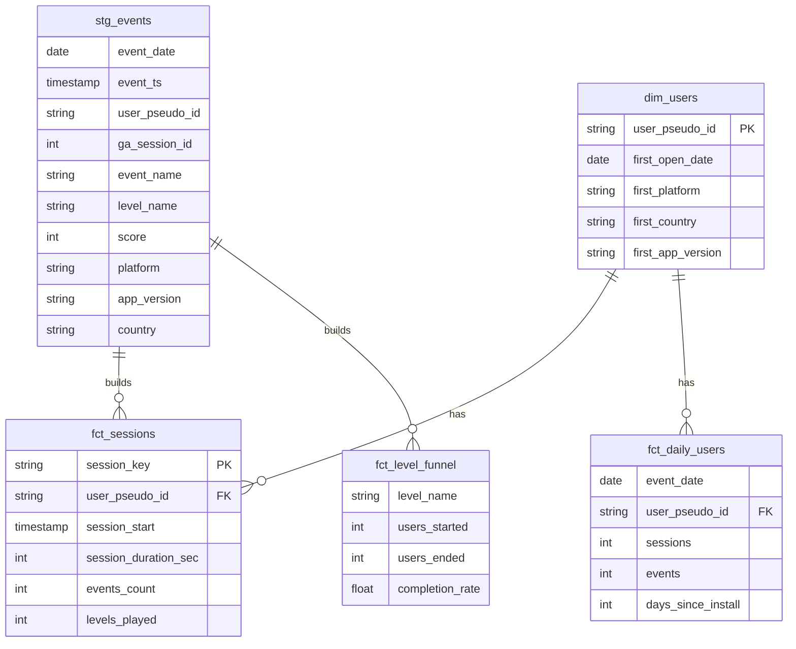

# 📱 Mobile App Event Data Validation & Product Analytics

> Validasi kualitas data event tracking Firebase dan analisis perilaku pengguna aplikasi mobile menggunakan **BigQuery (SQL)** dan **Looker Studio**.

   

---

## 📌 Daftar Isi
1. [Latar Belakang](#-latar-belakang)
2. [Masalah yang Diangkat](#-masalah-yang-diangkat)
3. [Tujuan Project](#-tujuan-project)
4. [Dataset](#-dataset)
5. [Tech Stack](#-tech-stack)
6. [Alur Project](#-alur-project)
7. [Tahapan Pengerjaan](#-tahapan-pengerjaan)
8. [Data Model](#-data-model)
9. [Definisi Metrik](#-definisi-metrik)
10. [Dashboard](#-dashboard)
11. [Hasil & Insight](#-hasil--insight)
12. [Rekomendasi](#-rekomendasi)
13. [Keterbatasan](#-keterbatasan)
14. [Relevansi ke Aplikasi Streaming / OTT](#-relevansi-ke-aplikasi-streaming--ott)
15. [Struktur Repository](#-struktur-repository)
16. [Cara Menjalankan](#-cara-menjalankan)

---

## 🧭 Latar Belakang

*Flood-It!* adalah game puzzle mobile (Android & iOS) yang mengirim setiap aktivitas pengguna ke **Firebase Analytics**: membuka aplikasi, memulai level, menyelesaikan level, memakai item, hingga menonton iklan. Data mentah ini diekspor ke **BigQuery** dalam format *nested* (satu baris per event, dengan detail di kolom `event_params`).

Tim produk ingin memahami **di mana pengguna berhenti bermain dan mengapa retensi turun**. Namun keputusan produk hanya bisa diambil jika **data tracking-nya dapat dipercaya**. Event yang hilang, duplikat, atau parameter yang kosong dapat menghasilkan insight yang salah.

## ❓ Masalah yang Diangkat

**Bagian A: Kualitas data (Data Validation)**
1. Apakah semua event terkirim dengan parameter yang lengkap dan tipe data yang benar?
2. Apakah ada event duplikat atau urutan event yang tidak logis (misalnya `level_end` tanpa `level_start`)?
3. Apakah ada versi aplikasi atau platform yang tracking-nya rusak (volume event tiba-tiba turun)?

**Bagian B: Perilaku pengguna (Product Analytics)**
1. Berapa pengguna aktif harian/bulanan, dan seberapa "lengket" aplikasinya?
2. Berapa persen pengguna baru yang kembali di hari ke-1, ke-7, dan ke-30?
3. Di tahap mana pengguna paling banyak berhenti (funnel drop-off)?
4. Apakah ada perbedaan perilaku antar platform, negara, dan versi aplikasi?

## 🎯 Tujuan Project

| # | Tujuan | Output |
|---|---|---|
| 1 | Mendokumentasikan event & parameter yang dikirim aplikasi | **Tracking plan** (`docs/tracking_plan.md`) |
| 2 | Membuktikan data layak dipakai sebelum dianalisis | **Data quality report** per event |
| 3 | Mengubah data nested menjadi tabel analitik yang rapi | Tabel **staging & mart** di BigQuery |
| 4 | Menjawab pertanyaan produk dengan metrik yang jelas | Analisis retention, funnel, engagement |
| 5 | Menyajikan hasil untuk stakeholder non-teknis | **Dashboard Looker Studio** + rekomendasi |

## 🗂 Dataset

| Item | Keterangan |
|---|---|
| Sumber | Google BigQuery public dataset |
| Tabel | `firebase-public-project.analytics_153293282.events_*` |
| Aplikasi | *Flood-It!* (Android & iOS) |
| Periode | ± Juni–Oktober 2018 (*sharded* per hari: `events_YYYYMMDD`) |
| Granularitas | 1 baris = 1 event oleh 1 pengguna pada 1 waktu |
| Skema | Firebase / GA4 export standar |

Kolom utama:

| Kolom | Tipe | Isi |
|---|---|---|
| `event_date`, `event_timestamp` | STRING, INT64 | Waktu event |
| `event_name` | STRING | Jenis aktivitas |
| `event_params` | ARRAY<STRUCT> | Detail aktivitas (key–value, perlu `UNNEST`) |
| `user_pseudo_id` | STRING | ID pengguna anonim |
| `user_properties` | ARRAY<STRUCT> | Atribut pengguna |
| `device`, `geo`, `app_info` | STRUCT | Perangkat, lokasi, versi aplikasi |
| `platform` | STRING | ANDROID / IOS |

## 🛠 Tech Stack

| Tools | Kegunaan |
|---|---|
| **BigQuery (SQL)** | Eksplorasi, validasi, transformasi, agregasi |
| **Looker Studio** | Dashboard interaktif |
| **Firebase Analytics** | Sumber data event |
| **Google Tag Manager + GA4** *(opsional)* | Praktik implementasi & testing event tracking |
| **GitHub** | Dokumentasi & version control |

## 🔄 Alur Project



## 🧱 Tahapan Pengerjaan

### 1. Eksplorasi data
- Rentang tanggal, jumlah pengguna, jumlah event.
- Daftar `event_name` beserta frekuensinya.
- Daftar `key` di `event_params` per event beserta tipe nilainya (`string_value` / `int_value` / `double_value`).

### 2. Tracking plan
Dokumen yang menjelaskan setiap event: kapan dipicu, parameter apa yang wajib, dan tipe datanya. Menjadi **acuan** untuk validasi di tahap berikutnya.

| event_name | Trigger | Parameter wajib | Tipe |
|---|---|---|---|
| `first_open` | Pertama kali aplikasi dibuka setelah install | – | – |
| `session_start` | Sesi baru dimulai | `ga_session_id` | INT |
| `level_start_quickplay` | Pengguna memulai level | `level_name` | STRING |
| `level_end_quickplay` | Level berakhir | `level_name` | STRING |
| `post_score` | Skor dicatat | `score`, `level_name` | INT, STRING |
| … | … | … | … |

*Nama event final disesuaikan dengan hasil eksplorasi.*

### 3. Data validation
| Cek | Pertanyaan | Contoh logika SQL |
|---|---|---|
| **Completeness** | Parameter wajib kosong? | `COUNTIF(level_name IS NULL) / COUNT(*)` per event |
| **Uniqueness** | Ada event duplikat? | `GROUP BY user_pseudo_id, event_name, event_timestamp HAVING COUNT(*) > 1` |
| **Validity** | Tipe nilai sesuai? Nilai masuk akal? | `score < 0`, nilai di kolom tipe yang salah |
| **Sequence** | Urutan event logis? | `level_end` tanpa `level_start` sebelumnya di sesi yang sama |
| **Consistency** | Pengguna punya `first_open`? | Pengguna aktif tanpa event `first_open` |
| **Anomaly** | Volume event wajar per versi/platform? | Event harian per `app_info.version`, cari penurunan tajam |

Output: tabel **data quality scorecard** (event × jenis cek × % lolos).

### 4–5. Transformasi (staging → mart)
Mengubah data nested menjadi tabel datar yang siap dianalisis dan dihubungkan ke Looker Studio (lihat [Data Model](#-data-model)).

### 6. Analisis
- **Engagement**: DAU, WAU, MAU, stickiness, durasi sesi, sesi per pengguna.
- **Retention**: cohort mingguan berdasarkan tanggal `first_open`, D1/D7/D30.
- **Funnel**: `first_open` → `level_start` → `level_end` → `post_score`, serta drop-off per level.
- **Segmentasi**: platform, negara, versi aplikasi.

### 7. Dashboard
Dibangun di Looker Studio dengan sumber tabel mart BigQuery.

### 8. Insight & rekomendasi
Diringkas dalam bahasa bisnis di bagian [Hasil & Insight](#-hasil--insight).

## 🧩 Data Model



## 📏 Definisi Metrik

| Metrik | Definisi |
|---|---|
| **DAU / MAU** | Jumlah `user_pseudo_id` unik yang punya minimal 1 event dalam sehari / 30 hari |
| **Stickiness** | DAU ÷ MAU, makin tinggi makin sering pengguna kembali |
| **Dn Retention** | % pengguna dari cohort `first_open` yang aktif tepat di hari ke-n setelah install |
| **Session** | Rangkaian event dengan `ga_session_id` yang sama |
| **Level completion rate** | Pengguna yang mencapai `level_end` ÷ pengguna yang `level_start` |
| **Data quality pass rate** | % baris event yang lolos semua cek validasi |

## 📊 Dashboard

| Halaman | Isi |
|---|---|
| **1. Data Health** | Scorecard kualitas data, volume event harian per versi/platform, daftar issue |
| **2. Overview** | DAU/MAU, stickiness, pengguna baru, sesi per pengguna |
| **3. Retention** | Cohort heatmap, kurva D1/D7/D30 |
| **4. Funnel & Level** | Funnel utama, completion rate per level, titik drop-off |
| **5. Segmentasi** | Perbandingan platform, negara, versi aplikasi |

🔗 *Link dashboard: (diisi setelah publish)*

## 💡 Hasil & Insight

> *Diisi setelah analisis selesai. Tulis angka dan artinya bagi bisnis.*

**Kualitas data**
- …

**Perilaku pengguna**
- …

## ✅ Rekomendasi

> *Contoh format: masalah → bukti angka → aksi → metrik yang dipantau.*

1. …
2. …
3. …

## ⚠️ Keterbatasan
- Dataset adalah **sampel publik** dari satu game pada tahun 2018, bukan data produksi terkini.
- Tidak ada data revenue lengkap atau atribusi kampanye.
- `user_pseudo_id` berbasis instalasi aplikasi, sehingga satu orang dengan dua perangkat terhitung dua pengguna.
- Validasi dilakukan pada data hasil export. Pengujian langsung di aplikasi (Firebase DebugView) tidak dapat dilakukan karena tidak ada akses ke aplikasi aslinya. Sebagai gantinya, praktik testing dilakukan di website demo dengan GTM + GA4 *(opsional)*.

## 📺 Relevansi ke Aplikasi Streaming / OTT

Struktur data Firebase sama untuk semua jenis aplikasi. Hanya nama event yang berbeda:

| Game (dataset ini) | Aplikasi streaming |
|---|---|
| `level_start` | `video_play` |
| `level_end` | `video_complete` |
| `level_name` | `content_title`, `content_id` |
| `use_extra_steps` | `skip_ad`, `subscribe_click` |
| Completion rate per level | Completion rate per konten / episode |
| Retention pemain | Retention penonton |

## 📁 Struktur Repository

```
firebase-product-analytics/
├── README.md
├── docs/
│   ├── tracking_plan.md
│   ├── data_quality_report.md
│   └── images/                 # screenshot dashboard, diagram
├── sql/
│   ├── 00_exploration/
│   ├── 01_validation/
│   ├── 02_staging/
│   ├── 03_marts/
│   └── 04_analysis/
└── gtm_demo/                   # (opsional) website demo + screenshot testing
```

## ▶️ Cara Menjalankan
1. Buka [BigQuery Console](https://console.cloud.google.com/bigquery) dan aktifkan **BigQuery Sandbox** (gratis).
2. Buat dataset sendiri, misalnya `flood_it_analytics`, untuk menyimpan tabel staging dan mart.
3. Jalankan file SQL secara berurutan: `00_exploration` → `01_validation` → `02_staging` → `03_marts` → `04_analysis`.
4. Hubungkan Looker Studio ke tabel di `flood_it_analytics`.

---

👤 **Author:** *(nama kamu)* · [LinkedIn](#) · [Email](#)
